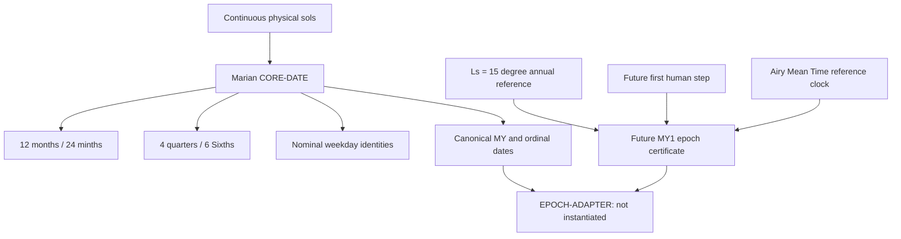

# Marian architecture and implementation layers

This diagram is conceptual; only the linked specification is normative.

**CORE-DATE:** integer, deterministic, independently implementable now for regular years MY1 onward. Returns civil date, ordinal-sol date, zero-based elapsed-sol offset and derived structural units. A shortened terminal civil week changes weekday labels, *never* the number of physical sols.

**Clock profile:** the author-ratified `MARIAN-AIRY-AMT-MARS24-2025-01-07-v1` convention fixes the computational mean-sol rollover. It is a model-defined reference clock, not a real-time ephemeris observation service.

**EPOCH-ADAPTER:** logically connects an authenticated future MY1 start instant with the integer CORE-DATE offsets, using the clock profile and required external time-scale transformations. It is **not ready to emit actual UTC timestamps** because the human event and certificate are uninstantiated.

**Astronomy:** the Ls = 15° reference describes the intended Mars-season position. Seasonal recurrence results in `research/` are model-dependent and do not override calendar arithmetic. Local time zones, communications light time and planetary navigation remain outside Marian CORE-DATE.

**Version layers:** civil rule `marian-civil-v1.0`; clock profile ID separate; future epoch certificate ID separate. Changing one layer must not silently rebrand or mutate another. See [version governance](../protocol/governance/VERSIONING-AND-CHANGE-CONTROL.md).
